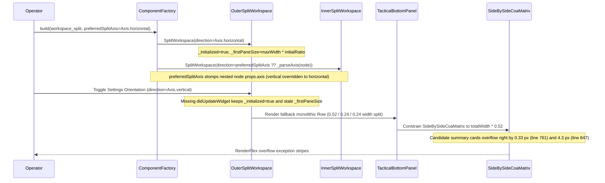

## 1. Context and References

<!-- test-target: app_flutter/test/features/layout/split_workspace_test.dart -->

- **File**: `app_flutter/lib/features/layout/split_workspace.dart:40-316`
- **Pillar**: Resource Lifecycle
- **Symptom**: Switching workspace layout orientation in Settings fails to re-orient or recalculate `SplitWorkspace` pane geometry because `_SplitWorkspaceState` caches `_initialized` and `_firstPaneSize` without a `didUpdateWidget` lifecycle handler; simultaneously, `ComponentFactory` unconditionally overrides every nested `SplitWorkspace` node's axis with `preferredSplitAxis`, `MainFlutterWindow.swift` launches at a cramped 800x600 frame, and downstream `TacticalBottomPanel` bypasses the declarative LUI AST with a hardcoded horizontal `Row` (0.52 / 0.24 / 0.24 width split) that triggers `RenderFlex` right-overflow exceptions in `SideBySideCoaMatrix` (0.33 px at line 761 and 4.3 px at line 847).
- **Test-Target**: `app_flutter/test/features/layout/split_workspace_test.dart`

## 2. Root Cause Analysis (5 Whys)

1. **Why does the right-hand workspace pane crush `SideBySideCoaMatrix`, `TelemetryInjectionPanel`, and `CoaInspectorPanel` into a horizontal row that throws `RenderFlex` overflow exceptions (0.33 px and 4.3 px) and fails to respond to Settings orientation toggles?** Because `TacticalBottomPanel` (`app_flutter/lib/features/layout/tactical_bottom_panel.dart:376-426`) hardcodes all three panels inside a `Row` with fixed fractional widths (`0.52`, `0.24`, `0.24`) instead of composing them vertically (1/3 : 1/3 : 1/3) via declarative `SplitWorkspace` AST nodes, while `SplitWorkspace` caches its initial axis state permanently.
2. **Why did a proposed remediation specify `SplitWorkspace` with `direction: Axis.horizontal` to stack the three panels Top / Middle / Bottom with horizontal divider bars?** Because of an inverted axis model blunder -- in Flutter and `SplitWorkspace` (`app_flutter/lib/features/layout/split_workspace.dart:138-305`), `Axis.horizontal` positions children side-by-side along the X-axis (`left` and `width` with a vertical divider strip), whereas stacking panes Top / Middle / Bottom with horizontal divider bars requires `Axis.vertical` (`top` and `height`).
3. **Why did downstream `app_flutter/assets/logical-layout.json` (lines 931--954) bypass the declarative LUI AST mandate by mounting `TacticalBottomPanel` with `children: []` and an ad-hoc `"mounted_panels"` string array?** Because upstream `ComponentFactory.build` (`app_flutter/lib/features/layout/component_factory.dart:199-220`) cannot recursively compose arbitrary nested `SplitWorkspace` children and unconditionally stomps every nested `SplitWorkspace` node's `direction` with `preferredSplitAxis ?? _parseAxis(node)`.
4. **Why does toggling the workspace orientation between Horizontal and Vertical in Settings leave the running layout unresponsive or mis-proportioned?** Because `_SplitWorkspaceState` (`app_flutter/lib/features/layout/split_workspace.dart:124-157`) sets `_initialized = true` on first build and omits `didUpdateWidget(SplitWorkspace oldWidget)`, retaining stale `_firstPaneSize` and `_draggedPaneSize` pixel values computed against the previous axis constraint (`maxWidth` vs `maxHeight`).
5. **Why do these layout and viewport compression defects immediately clip HUD headers and overflow candidate summary cards on desktop launch?** Because upstream `SplitWorkspace`, `ComponentFactory`, and `MainFlutterWindow.swift` (`app_flutter/macos/Runner/MainFlutterWindow.swift:4-15`, which preserves the nib's cramped 800x600 window frame instead of desktop high-density scale of at least 1440x900 or 1920x1200) lack lifecycle synchronization on widget configuration updates, per-node AST axis isolation, and minimum desktop viewport bounds.

## 3. Correctness Analysis

The defect cluster spans six coupled failure points across the upstream layout engine and its downstream realization:

1. **Right-Pane 3-Panel Layout Inversion & Horizontal Squashing (`app_flutter/lib/features/layout/tactical_bottom_panel.dart:376-426`)**:
   - Lines 381--385 compute hardcoded horizontal pixel widths from `totalWidth`: `matrixWidth = totalWidth * 0.52` (`SideBySideCoaMatrix`), `telemetryWidth = totalWidth * 0.24` (`TelemetryInjectionPanel`), and `inspectorWidth = totalWidth * 0.24` (`CoaInspectorPanel`).
   - Lines 386--424 place all three panels inside a `Row` wrapped in a `SingleChildScrollView(scrollDirection: Axis.horizontal)`, forcing the three panels into a side-by-side horizontal strip instead of a vertical 1/3 : 1/3 : 1/3 stack.
   - Specifying `SplitWorkspace` with `direction: Axis.horizontal` to achieve Top / Middle / Bottom stacking with horizontal divider bars inverts Flutter's axis semantics: in `app_flutter/lib/features/layout/split_workspace.dart:138-140` and `263-304`, `widget.direction == Axis.horizontal` measures `constraints.maxWidth`, sizes the divider as a vertical bar (`width: resolvedDividerSize, height: double.infinity` at lines 225--226), and offsets panes via `left` and `width`. Stacking Top / Middle / Bottom with horizontal divider bars requires `Axis.vertical`.

2. **RenderFlex Overflow Exceptions in COA Matrix (`app_flutter/lib/features/tables/side_by_side_coa_matrix.dart:761` and `847`)**:
   - When `SideBySideCoaMatrix` is compressed into the `0.52` fractional width pane, the candidate summary cards `Row` and metric badges exceed available horizontal constraints and throw runtime Flutter rendering exceptions:
     - `A RenderFlex overflowed by 0.33 pixels on the right.` (`side_by_side_coa_matrix.dart:761`)
     - `A RenderFlex overflowed by 4.3 pixels on the right.` (`side_by_side_coa_matrix.dart:847`)

3. **Unresponsive Settings Orientation Toggle -- `SplitWorkspace` State Caching (`app_flutter/lib/features/layout/split_workspace.dart:40-316`)**:
   - `_SplitWorkspaceState` (lines 124--128) declares mutable state fields `_firstPaneSize = 0`, `_draggedPaneSize`, and `_initialized = false`.
   - Inside `build` (lines 142--145), `_firstPaneSize = totalSize * widget.initialRatio` executes only once when `!_initialized && totalSize > 0`, after which `_initialized` is latched to `true`.
   - `_SplitWorkspaceState` defines no `didUpdateWidget(SplitWorkspace oldWidget)` lifecycle method. When the operator switches orientation in Settings and the parent rebuilds `SplitWorkspace` with a new `direction` (`Axis.horizontal` vs `Axis.vertical`) or `initialRatio`, `_initialized` remains `true`, `_draggedPaneSize` is not cleared, and `_firstPaneSize` retains the pixel length from the prior axis.
   - **Invariant Violated**: Stateful layout widgets parameterized by `direction` and `initialRatio` must synchronize internal state in `didUpdateWidget` whenever `oldWidget.direction != widget.direction` or `oldWidget.initialRatio != widget.initialRatio`.

4. **Nested AST Split Stomping in `ComponentFactory` (`app_flutter/lib/features/layout/component_factory.dart:199-220`)**:
   - In `case 'SplitWorkspace':` (lines 200--220), `ComponentFactory.build` unconditionally passes `direction: preferredSplitAxis ?? _parseAxis(node)` (line 216) and `splitterKey: const Key('horizontal_splitter')` (line 219), while filtering `childrenList` exclusively for `'TopographicalView'` and `'TabbedContainer'` (lines 201--208).
   - When a secondary `SplitWorkspace` (such as a vertical 3-panel stack with `props.axis: "vertical"`) is nested inside a primary `SplitWorkspace` (with `preferredSplitAxis: Axis.horizontal`), `preferredSplitAxis` propagates to and overwrites every nested `SplitWorkspace` node's declared axis, forcing the entire hierarchy onto a single axis and dropping non-hardcoded child node types.
   - **Invariant Violated**: User-selected shell orientation (`preferredSplitAxis`) must apply only to the target primary workspace split and must not overwrite explicit `props.axis` declarations on nested `SplitWorkspace` AST nodes.

5. **Desktop Window Launch Scale Deficit (`app_flutter/macos/Runner/MainFlutterWindow.swift:4-15`)**:
   - `MainFlutterWindow.awakeFromNib()` reads `let windowFrame = self.frame` from `MainMenu.xib` (800x600 default) and calls `self.setFrame(windowFrame, display: true)` (lines 7--9) without configuring a desktop workstation canvas size (at least 1440x900 or 1920x1200) or minimum content size, causing immediate HUD header and panel clipping on launch.

6. **Bypassing Declarative LUI AST Mandate (`app_flutter/assets/logical-layout.json:931-954`)**:
   - In `logical-layout.json` (lines 931--954), `TacticalBottomPanel` is mounted inside `workspace_split` with `children: []` and `"mounted_panels": ["SideBySideCoaMatrix", "TelemetryInjectionPanel", "CoaInspectorPanel"]`.
   - Because upstream `ComponentFactory` and `SplitWorkspace` failed to support nested multi-axis splits and live axis updates, downstream layout composition bypassed the declarative LUI AST in favor of a hardcoded monolithic widget.

## 4. UML Diagrams



## 5. Affected Callers / Downstream Impact

- `app_flutter/lib/features/layout/split_workspace.dart` (`SplitWorkspace` / `_SplitWorkspaceState`) -- Fails to reset `_initialized`, `_firstPaneSize`, and `_draggedPaneSize` when `direction` or `initialRatio` changes across widget rebuilds.
- `app_flutter/lib/features/layout/component_factory.dart` (`ComponentFactory.build`) -- Overwrites `props.axis` on all nested `SplitWorkspace` AST nodes when `preferredSplitAxis` is non-null, and discards nested `SplitWorkspace` children that are not `TopographicalView` or `TabbedContainer`.
- `app_flutter/lib/features/layout/tactical_bottom_panel.dart` (`TacticalBottomPanel`) -- Bypasses declarative LUI AST splitting by hardcoding a 3-panel horizontal `Row` (`0.52`, `0.24`, `0.24`), squashing vertical panels side-by-side.
- `app_flutter/lib/features/tables/side_by_side_coa_matrix.dart` (`SideBySideCoaMatrix` lines 761 and 847) -- Suffers `RenderFlex` right-overflow exceptions (0.33 px and 4.3 px) when rendered inside the squashed horizontal pane.
- `app_flutter/macos/Runner/MainFlutterWindow.swift` (`MainFlutterWindow.awakeFromNib`) -- Launches macOS desktop window at 800x600 default frame instead of high-density desktop canvas dimensions.
- `app_flutter/assets/logical-layout.json` (`workspace_split` lines 931--954) -- Uses `children: []` and ad-hoc `"mounted_panels"` array instead of declarative nested `SplitWorkspace` AST nodes.

## 6. Proposed Correction

```dart
// Empirical reproduction & lifecycle invariant contract in _SplitWorkspaceState
// (app_flutter/lib/features/layout/split_workspace.dart:124-146)
class _SplitWorkspaceState extends State<SplitWorkspace> {
  double _firstPaneSize = 0;
  double? _draggedPaneSize;
  bool _initialized = false;

  @override
  void didUpdateWidget(covariant SplitWorkspace oldWidget) {
    super.didUpdateWidget(oldWidget);
    if (oldWidget.direction != widget.direction ||
        oldWidget.initialRatio != widget.initialRatio) {
      _initialized = false;
      _draggedPaneSize = null;
    }
  }
}
```

## 7. Relationship to Existing Issues

Discovered in audit -- new finding.

## Audit Source

Adversarial Resource Lifecycle Audit
SEVERITY: Critical
FILE_LOCATION: app_flutter/lib/features/layout/split_workspace.dart:40-316
