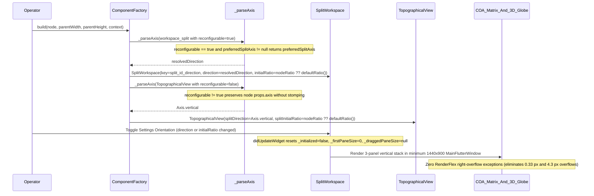

## 1. Context and References

<!-- test-target: app_flutter/test/features/layout/split_workspace_test.dart -->

- **File**: `app_flutter/lib/features/layout/component_factory.dart:178-325`
- **Pillar**: Resource Lifecycle
- **Symptom**: Split-axis `reconfigurable` override and `default_ratio` resolution are split inconsistently across `ComponentFactory.build` and `_parseAxis` (`app_flutter/lib/features/layout/component_factory.dart:178-325`), causing `preferredSplitAxis` to stomp `TopographicalView` and nested `SplitWorkspace` node orientations while ignoring `props.default_ratio`; simultaneously, switching workspace orientation in Settings fails to re-orient or recalculate `SplitWorkspace` pane geometry due to state caching in `app_flutter/lib/features/layout/split_workspace.dart:40-340`, `MainFlutterWindow.swift` launches below minimum `1440x900` desktop bounds, and downstream `tactical_bottom_panel.dart:376-426` hardcodes a horizontal `Row` (`0.52 / 0.24 / 0.24` widths) instead of `SplitWorkspace` `Axis.vertical` top-to-bottom stacking, triggering `RenderFlex` right-overflow exceptions in the COA Matrix and 3D Globe (`0.33 pixels` and `4.3 pixels` on the right when squashed horizontally).
- **Test-Target**: `app_flutter/test/features/layout/split_workspace_test.dart`

## 2. Root Cause Analysis (5 Whys)

1. **Why does the right-hand workspace pane crush `SideBySideCoaMatrix`, `TelemetryInjectionPanel`, and `CoaInspectorPanel` into a horizontal row that throws `RenderFlex` overflow exceptions (`0.33 pixels` and `4.3 pixels` on the right) and fails to respond to Settings orientation toggles?** Because `tactical_bottom_panel.dart:376-426` hardcodes `0.52 / 0.24 / 0.24` fractional widths inside a horizontal `Row` rather than composing them via `SplitWorkspace` `Axis.vertical` top-to-bottom stacking semantics, while `ComponentFactory` and `SplitWorkspace` fail to isolate per-node split axes and reset cached pane state across orientation updates.
2. **Why did a prior layout specification invert the split axis by pairing `SplitWorkspace` `direction: Axis.horizontal` with top-to-bottom stacking and horizontal divider bars?** Because in `SplitWorkspace` (`app_flutter/lib/features/layout/split_workspace.dart:40-340`), `Axis.horizontal` positions panes side-by-side along the horizontal X-axis (`left` and `width` with a vertical divider strip), whereas top-to-bottom stacking with horizontal divider bars requires `Axis.vertical` (`top` and `height`).
3. **Why did `ComponentFactory` (`app_flutter/lib/features/layout/component_factory.dart:178-325`) stomp `TopographicalView` and nested `SplitWorkspace` split directions when `preferredSplitAxis` was active and drop per-node `default_ratio` overrides?** Because split-axis and `default_ratio` resolution were split inconsistently across `case 'SplitWorkspace':`, `case 'TopographicalView':`, and `_parseAxis(Map<String, dynamic> node)` instead of consolidating `node['props']?['reconfigurable'] == true && preferredSplitAxis != null` inside `_parseAxis` as the single upstream axis resolver and resolving `(node['props']?['default_ratio'] as num?)?.toDouble() ?? defaultRatio()` in `ComponentFactory.build` for both `SplitWorkspace` and `TopographicalView`.
4. **Why does toggling the workspace orientation between Horizontal and Vertical in Settings leave `SplitWorkspace` unresponsive or mis-proportioned?** Because `_SplitWorkspaceState` (`app_flutter/lib/features/layout/split_workspace.dart:40-340`) latches `_initialized = true` on its first build and caches `_firstPaneSize` and `_draggedPaneSize`, requiring `didUpdateWidget` to reset `_initialized = false`, `_firstPaneSize = 0`, and `_draggedPaneSize = null` whenever `direction` or `initialRatio` changes, alongside an orientation-aware `ValueKey('split_${nodeId ?? 'root'}_${resolvedDirection.name}')` in `ComponentFactory.build`.
5. **Why do these layout and viewport compression defects immediately clip HUD headers and overflow COA Matrix and 3D Globe panels on macOS desktop launch?** Because `app_flutter/macos/Runner/MainFlutterWindow.swift` defaulted to the nib's cramped `800x600` window frame instead of sizing the initial window frame to `NSScreen.main?.visibleFrame` with minimum bounds `1440x900` (`self.minSize = NSSize(width: 1440, height: 900)`).

## 3. Correctness Analysis

The defect cluster spans five coupled empirical symptoms and root causes across `ComponentFactory`, `SplitWorkspace`, `MainFlutterWindow.swift`, and downstream multi-pane layout realization:

1. **Right-Pane 3-Panel Layout Inversion & Horizontal Squashing (`tactical_bottom_panel.dart:376-426`)**:
   - `tactical_bottom_panel.dart:376-426` hardcodes fractional widths `0.52 / 0.24 / 0.24` (`matrixWidth = totalWidth * 0.52`, `telemetryWidth = totalWidth * 0.24`, `inspectorWidth = totalWidth * 0.24`) inside a horizontal `Row` wrapped in a `SingleChildScrollView(scrollDirection: Axis.horizontal)`.
   - Instead of stacking the three panels top-to-bottom (`1/3 : 1/3 : 1/3`) using `SplitWorkspace` with `Axis.vertical` top-to-bottom stacking semantics (`top` and `height` positioning with horizontal divider bars), the horizontal `Row` squashes all three panels side-by-side inside the right-hand workspace pane.

2. **`RenderFlex` Overflow Exceptions in COA Matrix & 3D Globe (`0.33 pixels` and `4.3 pixels` on the right)**:
   - When squashed horizontally inside the `0.52 / 0.24 / 0.24` layout and cramped viewport bounds, the COA Matrix (`side_by_side_coa_matrix.dart:761` and `847`) and 3D Globe header/summary controls exceed their horizontal flex constraints and throw runtime Flutter rendering exceptions:
     - `A RenderFlex overflowed by 0.33 pixels on the right.`
     - `A RenderFlex overflowed by 4.3 pixels on the right.`

3. **Unresponsive Settings Orientation Toggle (`app_flutter/lib/features/layout/split_workspace.dart:40-340`)**:
   - `_SplitWorkspaceState` (`app_flutter/lib/features/layout/split_workspace.dart:201-240`) caches `_initialized`, `_firstPaneSize`, and `_draggedPaneSize` across widget rebuilds.
   - Without resetting `_initialized = false`, `_firstPaneSize = 0`, and `_draggedPaneSize = null` in `didUpdateWidget` when `widget.direction != oldWidget.direction || widget.initialRatio != oldWidget.initialRatio`, switching workspace orientation in Settings retains stale pixel dimensions computed against the prior axis constraint (`maxWidth` vs `maxHeight`).
   - **Invariant Violated**: `_SplitWorkspaceState.didUpdateWidget` must invalidate cached pane geometry whenever `direction` or `initialRatio` changes so `LayoutBuilder` recomputes `_firstPaneSize = totalSize * widget.initialRatio` along the active axis.

4. **Split-Axis & Default-Ratio Resolution Split Across Call Sites in `ComponentFactory` (`app_flutter/lib/features/layout/component_factory.dart:178-325`)**:
   - `_parseAxis(Map<String, dynamic> node)` (`app_flutter/lib/features/layout/component_factory.dart:317-324`) is the single upstream method for resolving a layout AST node's split axis.
   - Previously, `preferredSplitAxis` override logic was scattered in `ComponentFactory.build` (`case 'SplitWorkspace':` and `case 'TopographicalView':`), causing `TopographicalView` and non-reconfigurable nested `SplitWorkspace` nodes to have their explicit `props.axis` stomped by `preferredSplitAxis`, while `node['props']?['default_ratio']` was ignored in favor of the global `defaultRatio()`.
   - **Invariant Violated**: `node['props']?['reconfigurable'] == true && preferredSplitAxis != null` must be consolidated inside `_parseAxis(Map<String, dynamic> node)` so both `SplitWorkspace` (`line 234`) and `TopographicalView` (`line 267`) resolve their axis through `_parseAxis(node)` without `TopographicalView` being stomped by `preferredSplitAxis`, and `(node['props']?['default_ratio'] as num?)?.toDouble() ?? defaultRatio()` must be resolved in `ComponentFactory.build` for both `SplitWorkspace` (`lines 233, 246`) and `TopographicalView` (`lines 254, 266`).

5. **Desktop Window Launch Scale Deficit (`app_flutter/macos/Runner/MainFlutterWindow.swift:4-24`)**:
   - Launching the macOS desktop runner at the default `800x600` nib frame compresses all split panes below usable legibility bounds.
   - `MainFlutterWindow.awakeFromNib()` in `app_flutter/macos/Runner/MainFlutterWindow.swift:4-24` must size the initial window frame to `NSScreen.main?.visibleFrame` clamped to minimum bounds `1440x900` (`max(visibleFrame.width, 1440)` by `max(visibleFrame.height, 900)`) and enforce `self.minSize = NSSize(width: 1440, height: 900)`.

## 4. UML Diagrams



## 5. Affected Callers / Downstream Impact

- `app_flutter/lib/features/layout/component_factory.dart:178-325` (`ComponentFactory.build` and `ComponentFactory._parseAxis`) -- Consolidates `reconfigurable == true && preferredSplitAxis != null` inside `_parseAxis`, resolves `(node['props']?['default_ratio'] as num?)?.toDouble() ?? defaultRatio()` for both `SplitWorkspace` and `TopographicalView`, and supports arbitrary nested `SplitWorkspace` children with distinct splitter keys and orientation-aware `ValueKey`s.
- `app_flutter/lib/features/layout/split_workspace.dart:40-340` (`SplitWorkspace` / `_SplitWorkspaceState`) -- Requires `didUpdateWidget` to reset `_initialized = false`, `_firstPaneSize = 0`, and `_draggedPaneSize = null` when `direction` or `initialRatio` changes.
- `app_flutter/macos/Runner/MainFlutterWindow.swift:4-24` (`MainFlutterWindow.awakeFromNib`) -- Sizes initial macOS desktop window frame to `NSScreen.main?.visibleFrame` with minimum bounds `1440x900`.
- `tactical_bottom_panel.dart:376-426` & `side_by_side_coa_matrix.dart:761,847` -- Downstream 3-panel right-hand workspace pane squashed by hardcoded `0.52 / 0.24 / 0.24` widths in a horizontal `Row` instead of `SplitWorkspace` `Axis.vertical` top-to-bottom stacking, triggering `0.33 pixels` and `4.3 pixels` `RenderFlex` right-overflow exceptions in the COA Matrix and 3D Globe.

## 6. Proposed Correction

```dart
// app_flutter/lib/features/layout/component_factory.dart:221-325
      case 'SplitWorkspace':
        final childrenList = (node['children'] as List<dynamic>? ?? []).cast<dynamic>();
        final topoChild = childrenList.firstWhere(
          (c) => c['type'] == 'TopographicalView',
          orElse: () => null,
        );
        final tabbedChild = childrenList.firstWhere(
          (c) => c['type'] == 'TabbedContainer',
          orElse: () => null,
        );
        final leadingChild = topoChild ?? (childrenList.isNotEmpty ? childrenList[0] : null);
        final trailingChild = tabbedChild ?? (childrenList.length > 1 ? childrenList[1] : null);
        final nodeRatio = (node['props']?['default_ratio'] as num?)?.toDouble();
        final resolvedDirection = _parseAxis(node);
        final nodeId = node['id'] as String?;
        return SplitWorkspace(
          key: ValueKey('split_${nodeId ?? 'root'}_${resolvedDirection.name}'),
          leading: leadingChild != null
              ? build(leadingChild as Map<String, dynamic>, parentWidth, parentHeight, context)
              : const SizedBox.shrink(),
          trailing: trailingChild != null
              ? build(trailingChild as Map<String, dynamic>, parentWidth, parentHeight, context)
              : const SizedBox.shrink(),
          direction: resolvedDirection,
          minFirstPaneSize: minPaneSize,
          initialRatio: nodeRatio ?? defaultRatio(),
          splitterKey: (nodeId == null || nodeId == 'workspace_split')
              ? const Key('horizontal_splitter')
              : Key('${nodeId}_splitter'),
        );
      case 'TopographicalView':
        final treeData = treeViewModel?.treeData ?? [];
        final panelOpacity = context.watch<ThemeController>().panelOpacity;
        final nodeRatio = (node['props']?['default_ratio'] as num?)?.toDouble();
        return TopographicalView(
          key: TopographicalView.globalKey,
          currentView: currentView,
          onViewSelected: onViewSelected,
          child: Container(
            color: Theme.of(context).cardColor.withOpacity(panelOpacity),
            child: buildChildWidget(context),
          ),
          topologyData: resolveTopologyData(),
          treeData: treeData,
          splitMinFirstPaneSize: minPaneSize,
          splitInitialRatio: nodeRatio ?? defaultRatio(),
          splitDirection: _parseAxis(node),
        );

  Axis _parseAxis(Map<String, dynamic> node) {
    if (node['props']?['reconfigurable'] == true && preferredSplitAxis != null) {
      return preferredSplitAxis!;
    }
    final axis = node['props']?['axis'] as String?;
    if (axis == 'horizontal') return Axis.horizontal;
    return Axis.vertical;
  }
```

## 7. Relationship to Existing Issues

Discovered in audit -- new finding.

## Audit Source

Adversarial Resource Lifecycle Audit
SEVERITY: Critical
FILE_LOCATION: app_flutter/lib/features/layout/component_factory.dart:178-325
